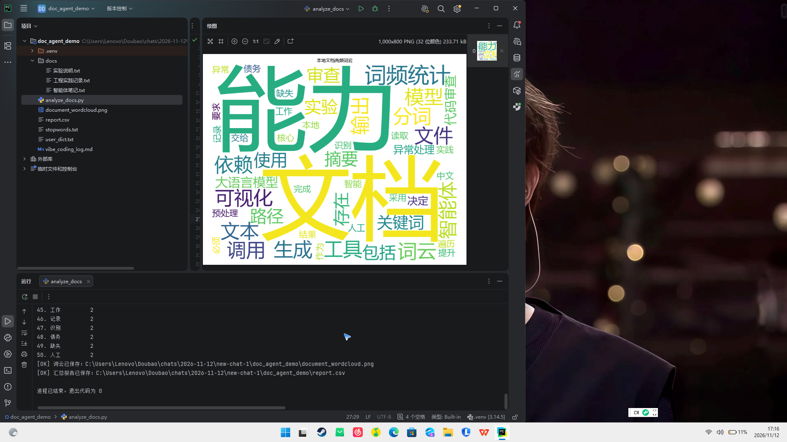

# 实验报告：本地文档智能审查与摘要（Vibe Coding 实验）

| 项目 | 内容 |
| --- | --- |
| 课程 | Python 程序设计 |
| 实验名称 | 实验四：本地文档智能审查与摘要（Vibe Coding） |
| 姓名 / 学号 | ________ / ________ |
| 完成日期 | 2026-11-18 |
| 仓库地址 | https://github.com/qls-eng/local-doc-review-lab |
| 运行环境 | Windows 11 + Python 3.13.18 + jieba / wordcloud / matplotlib |

## 一、实验目的

1. 实现一个能**批量处理本地文档**的小型工具：遍历文件夹 → 读取 txt/md → 中文分词 → 词频统计 → 可视化输出。
2. 用 Vibe Coding 方式推进：每一轮只加一小步，AI 产出后立刻运行验证，报错就修，修复过程写进 `vibe_coding_log.md`。
3. 处理中文文本处理的两个典型障碍：专业词被切碎（需自定义词典）、中文显示为方框（需字体配置）。
4. 保证程序在异常输入下不崩溃：目录不存在、单文件读取失败、无有效词汇、字体缺失。

## 二、功能与输入输出

| 项 | 说明 |
| --- | --- |
| 输入 | 程序所在目录下 `docs/` 中的 `.txt` / `.md` 文件（本仓库放 3 份样本） |
| 资源文件 | `stopwords.txt`（停用词 46 个）、`user_dict.txt`（自定义专业词典） |
| 处理 | jieba 分词 → 过滤停用词、单字、非字母数字 → Counter 统计 Top50 |
| 输出 | `report.csv`（排名/关键词/出现次数，utf-8-sig）+ `document_wordcloud.png`（白底 1000×800） |

## 三、技术选型

| 环节 | 选择 | 理由 |
| --- | --- | --- |
| 分词 | jieba | 中文分词最常用，支持 `load_userdict` 注入专业词 |
| 词云 | wordcloud | 直接吃 `{词: 频次}` 字典，配 `font_path` 可解决中文显示 |
| 绘图 / 展示 | matplotlib | 用于把词云图显示在窗口并加标题 |
| 统计 | `collections.Counter` | `most_common(n)` 一行拿 TopN |

## 四、实现要点

### 4.1 四步流水线

```python
def analyze(folder_path, font_path, stopwords_file=None, user_dict=None, top_n=50):
    load_user_dict(user_dict)      # 1. 加载自定义词典
    stopwords = load_stopwords(stopwords_file)   # 2. 加载停用词
    all_words = read_folder(folder_path, stopwords)  # 3. 遍历 + 分词 + 过滤
    ...
    top_words = Counter(all_words).most_common(top_n)  # 4. 统计 TopN
```

### 4.2 过滤规则

```python
filtered = [w.strip() for w in words
            if len(w.strip()) > 1 and w not in stopwords and w.strip().isalnum()]
```

三条同时满足才保留：长度 > 1（滤掉单字）、不在停用词表、是字母/数字（滤掉标点与空白）。

### 4.3 两个字体配置（本实验最关键的坑）

- **词云内部文字**：`WordCloud(font_path=r"C:\Windows\Fonts\msyh.ttc")`；
- **matplotlib 标题 / 坐标轴**：`plt.rcParams['font.sans-serif'] = ['Microsoft YaHei', 'SimHei']`，并关闭负号乱码 `axes.unicode_minus = False`。

两处是各自独立的配置，只设一处仍会有一半中文是方框。实验中先出现"词云中文全是方框"，补上 `font_path` 后又发现"窗口标题是方框"，才定位到这是两套字体体系。

### 4.4 路径与编码

- 所有输入输出路径基于 `os.path.dirname(os.path.abspath(__file__))` 拼接，换机器不失效；
- 读文件强制 `encoding='utf-8'`；
- 写 CSV 用 `utf-8-sig`，Excel 双击打开中文不乱码。

### 4.5 异常兜底

| 场景 | 行为 |
| --- | --- |
| 停用词表缺失 / 读取失败 | 打印 `[WARN]`，改用内置 15 个基础停用词 |
| 自定义词典加载失败 | 打印 `[WARN]`，继续用默认词典 |
| 目标文件夹不存在 | 打印 `[ERROR] 文件夹不存在：...`，返回空列表 |
| 单个文件读取失败 | 打印 `[ERROR]` 并跳过该文件，不影响其他文件 |
| 过滤后无有效词 | 打印 `[ERROR] 未提取到有效词汇`，不生成空图 |
| 找不到中文字体 | 打印 `[ERROR]` 并 `sys.exit(1)`，避免输出一堆方框 |

## 五、运行结果

在 PyCharm 中右键 `analyze_docs.py` 运行（解释器绑定项目 `.venv`），窗口截图：



本次真实运行输出（节选）：

```text
[OK] 使用字体：C:\Windows\Fonts\msyh.ttc
[OK] 已加载自定义词典：...\user_dict.txt
[OK] 已加载停用词 46 个：...\stopwords.txt
[OK] 共读取 3 个文件，有效词条 345 个

===== Top 50 高频词 =====
 1. 文档         7
 2. 能力         7
 3. 词频统计       5
 4. 文本         4
 5. 分词         4
 ...
[OK] 词云已保存：...\document_wordcloud.png
[OK] 汇总报告已保存：...\report.csv
```

产物核对：

| 产物 | 核对结果 |
| --- | --- |
| `report.csv` | 51 行（1 行表头 + Top50），列序 `排名,关键词,出现次数` |
| `document_wordcloud.png` | 1000×800 白底词云，中文正常显示 |
| 词条数 | 3 个文档共提取 345 个有效词条 |

生成的词云：


从词云可见，语料主题集中在"文档、能力、词频统计、摘要、审查、智能体、大语言模型"——正好是这三份样本（实验说明、智能体笔记、工程实践记录）的核心词，说明停用词过滤与自定义词典都起作用了（"词频统计""大语言模型""智能体"这类词没被切碎）。

## 六、Vibe Coding 过程记录

完整的多轮 Prompt 与报错修复见 `vibe_coding_log.md`，主要迭代节点：

| 轮次 | 需求 | 遇到的问题 | 修复 |
| --- | --- | --- | --- |
| R1 | 读取文件夹并分词 | `ModuleNotFoundError` | 改用项目 `.venv\Scripts\python.exe -m pip install` |
| R2 | 加词频统计 | 结果里全是"的、了、和" | 加停用词表过滤 |
| R3 | 加词云 | 中文全是方框 | 显式 `font_path` 指向 `msyh.ttc` |
| R4 | 展示词云窗口 | 窗口标题仍是方框 | `plt.rcParams['font.sans-serif']` 单独设置 |
| R5 | 专业词被切碎 | "词频统计"被拆成"词频/统计" | `jieba.load_userdict` 注入自定义词典 |
| R6 | 换电脑运行 | 路径全是绝对路径 | 改为基于 `__file__` 拼路径 |

## 七、小结

- 中文文本处理的门槛不在算法，而在两条"配置"：词典与字体。两者不配好，工具看起来能跑但结果是废的。
- 分层设计（加载 / 读取 / 统计 / 可视化各一个函数）让每次迭代只改一个函数，Vibe Coding 的"小步验证"才有可能。
- 异常兜底要"降级而不中断"：停用词读失败就用内置表，单文件读失败就跳过，这样批量任务不会因为一个坏文件全废。

## 八、后续可扩展

- 对接大模型 API，把关键词与词频交给模型生成审查意见与摘要；
- 引入 `watchdog` 监控文件夹，新增文档自动分析；
- 增加相似文档聚类，识别重复内容。

## 九、交付清单

| 交付物 | 位置 |
| --- | --- |
| 主程序 | `analyze_docs.py`（151 行） |
| 资源 | `stopwords.txt`、`user_dict.txt` |
| 样本语料 | `docs/实验说明.txt`、`docs/智能体笔记.txt`、`docs/工程实践记录.txt` |
| 运行产物 | `report.csv`、`document_wordcloud.png` |
| 过程记录 | `vibe_coding_log.md`、`run_output.txt` |
| 运行截图 | `pycharm运行截图.png` |
